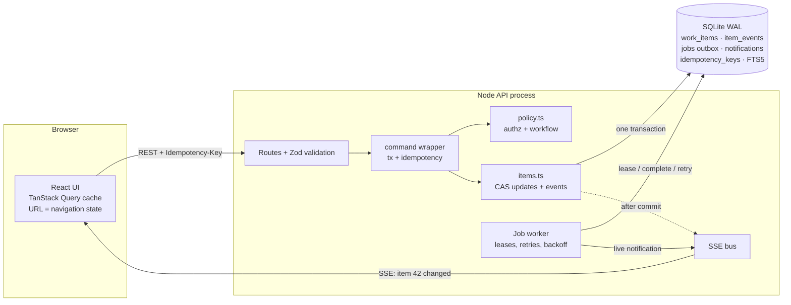

# Newtonite Ops — Operations Under Pressure

An internal web app for coordinating operational work (customer issues, payment investigations, incidents, compliance requests, approvals) across many teams — built so that ownership is unambiguous, history never disappears, and simultaneous use by many people behaves predictably.

- **Backend:** Node.js + TypeScript, Express 5, SQLite (WAL) via better-sqlite3, Zod validation
- **Frontend:** React 19 + TypeScript, Vite, TanStack Query, Server-Sent Events
- **Tests:** Vitest + Supertest (42 behaviour tests aimed at the riskiest parts)

See **[ENGINEERING_DECISIONS.md](ENGINEERING_DECISIONS.md)** for the reasoning and trade-offs.

---

## Running it

Requires **Node.js 22+** (better-sqlite3 13 requires it). No database server or Docker needed.

```bash
npm run setup          # install server + web dependencies
npm run seed           # demo teams/users + 5,000 work items with history
npm start              # builds the web app and serves everything on http://localhost:4000
```

Open http://localhost:4000 and pick a demo account (all passwords are `password`):

| Account | Access |
|---|---|
| `admin@newtonite.test` | Admin — everything |
| `priya@newtonite.test` | Lead in Payments, member in Operations |
| `rahul@newtonite.test` | Member in Payments and Engineering |
| `meera@newtonite.test` | Member in Payments and Customer Support |
| `vikram@newtonite.test` | Lead in Engineering and Operations |
| `kabir@newtonite.test` | Lead in Customer Support |
| `dev@newtonite.test` | Lead in Compliance, viewer in Payments |
| `vera@newtonite.test` | Viewer (read-only) in three teams |

**Tip:** open a normal and a private window as two different people (e.g. Rahul and Meera) on the same item to see live updates, claim races and edit conflicts.

### Other commands

```bash
npm test                              # backend test suite
npm run typecheck                     # server + web
ITEMS=30000 npm run seed              # scale test data (30k items, ~94k events)

# Development with hot reload (two terminals):
npm run dev:server                    # API on :4000
npm run dev:web                       # UI on :5173 (proxies /api to :4000)

# Demonstrate retries/backoff/dead-lettering of background jobs:
NOTIFY_FAILURE_RATE=0.5 npm start --prefix server

# Run the job worker as its own process (several can run at once):
RUN_WORKER=false npm start --prefix server   # API only
npm run worker --prefix server               # worker
```

Environment variables: `PORT` (default 4000), `DB_FILE` (default `server/data/ops.db`), `RUN_WORKER`, `NOTIFY_FAILURE_RATE`.

---

## What you can do

- **Needs attention** dashboard: assigned to me, awaiting my approval, urgent & unowned (P1/P2), overdue, going stale (P1/P2 with no activity for 24h), plus active counts by status. Every card links to the full list.
- **Lists** with saved views, team scoping, status/priority/kind filters, sorting, full-text search (or jump to `PAY-123`) and infinite scroll with cursor pagination. Press `/` to search, `c` to create.
- **Work items** with title, “why it exists” description, kind, priority P1–P4, owner, reporter, due date and optional approval requirement.
- **Workflow:** `open → in progress ⇄ blocked → resolved → closed`, plus `cancel`/`reopen`, and an approval gate (`request approval → approve/reject`) that must be passed before work can start. Decisions that need justification (block, resolve, reject, cancel, reopen) require a note.
- **Ownership:** take ownership (race-safe), release, or (leads) assign to a team member.
- **Collaboration & history:** comments and a complete, immutable timeline of every change — who, what, from → to, and why.
- **Notifications** for the reporter, owner, previous owner and (for P1s and approval requests) team leads, delivered asynchronously and pushed live.
- **Live updates:** other people’s changes appear within a second; rows flash with “updated by …”, and the open item shows who just changed it.

---

## Architecture



**Request path for a command** (e.g. *approve*):

1. Authenticate (session cookie → user + per-team roles, loaded fresh each request).
2. Validate body with Zod.
3. `BEGIN IMMEDIATE`; if the `Idempotency-Key` was already used → replay the stored response.
4. Load the item; **404** if the user can’t see its team.
5. Check `expectedVersion` → **409 VERSION_CONFLICT** (with the current item) if stale.
6. `decide(user, item, action)` → **403** (who you are) or **409 INVALID_TRANSITION** (what state it’s in).
7. Compare-and-swap `UPDATE … WHERE id = ? AND version = ?`.
8. Append an `item_events` row and enqueue a `notify` job with recipients — same transaction.
9. Store the idempotency key + response; `COMMIT`.
10. After commit: broadcast `item.changed` over SSE. The worker picks up the job and creates notifications idempotently.

### Code map

```
server/src/
  schema.sql          tables, indexes, FTS5 + triggers
  policy.ts           roles, workflow transitions, four-eyes rule, allowedActions
  items.ts            commands (create/update/claim/release/assign/transition/comment) and queries
  http.ts             command wrapper: transaction, idempotency, after-commit hooks, error mapping
  jobs.ts             durable job queue: leasing, retries, backoff, dead-lettering
  notifications.ts    idempotent notification handler, cleanup job
  bus.ts              SSE fan-out
  auth.ts             scrypt passwords, hashed session tokens, per-request roles
  app.ts              routes
server/test/          concurrency, idempotency, authorization, workflow, jobs, listing
web/src/
  api.ts              typed client, ApiError with codes
  mutations.ts        shared command behaviour: idempotency keys, retries, optimistic claim, reconciliation
  live.ts             SSE → cache invalidation, connection state
  components/         Dashboard, ItemList, ItemDetail (edit + conflict dialog), CreateItem, Notifications
```

---

## API overview

All endpoints are under `/api` and return JSON. Errors are `{ "error": { "code", "message", "details" } }` with stable codes (`VALIDATION_ERROR`, `UNAUTHENTICATED`, `FORBIDDEN`, `NOT_FOUND`, `VERSION_CONFLICT`, `ALREADY_CLAIMED`, `INVALID_TRANSITION`, `IDEMPOTENCY_KEY_REUSED`, `BUSY`, `INTERNAL`).

| Method | Path | Notes |
|---|---|---|
| POST | `/auth/login`, `/auth/logout` | Session cookie (HttpOnly, SameSite=Strict); login also returns a bearer token for scripts |
| GET | `/me` | User + teams + role per team |
| GET | `/teams/:id/members` | For assignment |
| GET | `/dashboard?teamId=` | Saved-query sections with counts |
| GET | `/items?teamId&status&priority&kind&assignee=me\|none\|id&reporter=me&q&overdue&stale&needsMyApproval&sort=activity\|priority\|created&cursor&limit` | Cursor-paginated |
| POST | `/items` | Create (201). Supports `Idempotency-Key` |
| GET | `/items/:id` | Includes `version` and `allowedActions` |
| PATCH | `/items/:id` | `{ expectedVersion, ...fields }` |
| POST | `/items/:id/claim` | Race-safe; no-op if you already own it |
| POST | `/items/:id/release` | `{ expectedAssigneeId }` |
| POST | `/items/:id/assign` | `{ expectedVersion, assigneeId \| null }` (leads) |
| POST | `/items/:id/transitions` | `{ expectedVersion, action, note? }` |
| GET | `/items/:id/events?after=` | History, paginated |
| POST | `/items/:id/comments` | `{ body }` |
| GET/POST | `/notifications`, `/notifications/read` | `{ upToId }` — idempotent |
| GET | `/stream` | Server-Sent Events: `item.changed`, `notification` |

All `POST`/`PATCH` endpoints accept `Idempotency-Key` (8–128 chars).

---

## Tests — what is covered and why

Tests target the behaviours that would be most damaging if wrong, not a coverage number.

| File | Risk it guards against |
|---|---|
| `concurrency.test.ts` | Two people owning the same work; stale edits overwriting newer data; approving a request that changed during review; a stale "release" unassigning a new owner; comments causing spurious conflicts |
| `idempotency.test.ts` | Double-clicks and retries creating duplicates (incl. a burst of 5 concurrent identical requests); key reuse for a different request; failures being "remembered"; partial effects from failed commands |
| `authorization.test.ts` | Leaking other teams' items (read, write, history, search); viewers changing things; members assigning others or waiving approval; self-approval; UI-visible actions disagreeing with server enforcement (exhaustive policy check) |
| `workflow.test.ts` | Invalid transitions; starting without an owner or approval; missing justification notes; approvals surviving a change of scope; history order and version monotonicity |
| `jobs.test.ts` | Change committed without its notification (or vice versa); duplicate notifications on re-delivery; retries/backoff/dead-lettering; crashed worker’s job never re-run, or a zombie worker overwriting the outcome; double enqueue |
| `listing.test.ts` | Pagination skipping/duplicating items while data changes; search input breaking FTS; tampered cursors; dashboard showing the wrong people's approvals or missing stale urgent work |

Run with `npm test` (≈8 s).

---

## Known limitations

- **Single-writer database.** SQLite serialises writes. This is ample for hundreds of concurrent users doing interactive work, but it is the first ceiling. All guards are compare-and-swap so the move to Postgres doesn't change behaviour.
- **SSE fan-out is in-process.** With more than one API instance, live updates need a shared channel (Redis pub/sub or Postgres `LISTEN/NOTIFY`). Clients already treat events as hints and refetch, so a missed event only delays freshness. If the worker runs as a separate process, notifications appear via 30-second polling instead of being pushed.
- **Lists refresh, they don't patch.** A change anywhere in your teams triggers (coalesced) refetches of visible lists. Fine at this scale; at higher write rates I'd patch cached rows from the event or narrow invalidation by filter.
- **Exact counts on the dashboard** use `COUNT(*)` over indexed predicates — fast at tens of thousands of items, but would want caching/approximation at millions.
- **No admin UI** for users/teams/roles (seeded); no password reset or SSO; no rate limiting on login.
- **Edit conflicts are resolved by the user**, not merged automatically.
- **Timezone handling** for due dates uses the browser's local time on input and UTC in storage; there is no per-user timezone setting.
- The seed generates plausible but random history (e.g. many overdue items), so dashboard counts look busier than a real team's would.

## If this grew significantly

1. **Postgres** (same schema; `SELECT … FOR UPDATE SKIP LOCKED` for job leasing; `tsvector` + GIN for search, or a search service once search needs relevance tuning and facets).
2. **Multiple stateless API instances** behind a load balancer, with SSE fan-out via Redis/`LISTEN/NOTIFY`, and workers as a separate deployment that scales with queue depth.
3. **Partition or archive `item_events`** by time; keep the hot timeline small, move old history to cheaper storage while keeping it queryable.
4. **Cache dashboard counts** (materialised per team, updated by the worker from events).
5. **Observability:** structured logs with request IDs, metrics for queue depth / job age / dead jobs / 409 rates (a rising conflict rate is a product signal), alerts on dead-letter growth.

## With another week

- Presence ("Meera is viewing / editing this") to prevent conflicts rather than resolve them.
- Watchers and @mentions, plus email/Slack delivery as new job types.
- SLA policies per team and priority, with escalation jobs and an audit of breaches.
- Admin UI for teams and roles, with membership changes recorded in an audit log.
- Bulk actions (assign/close many) with per-item results, built on the same idempotent commands.
- Frontend tests (Playwright) for the conflict dialog and claim-race flows; load test with k6 to find the real write ceiling.
